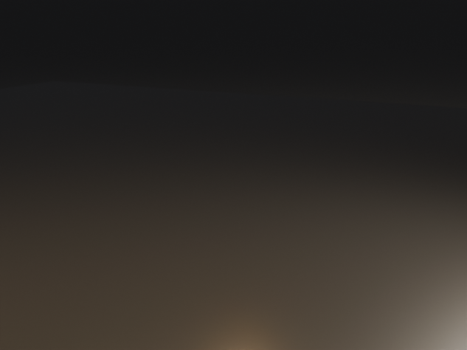
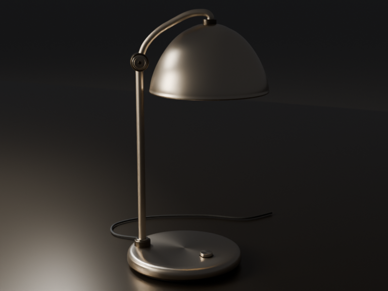

# 移动产品后，另存完整取景

0.22.0 候选新增完整取景：保留原相机、动画和镜头安排，在选定帧另存一个静态机位，让所选产品部件完整入镜。本版本尚未发布；当前 GitHub/npm 稳定版为 [0.21.0](releases/0.21.0.md)。

## 在工作台完成

1. 打开已保存的作品，进入「调整」中的「摄影：相机与灯光」。
2. 在「完整取景」选择要沿用方向的相机和明确帧。支持的完整台灯默认选中全部 23 件；其它模型请在「选择部件与留白」勾选完整产品，排除地面、支承和无关对象。
3. 检查留白，默认每边 3%，点击「保存完整取景」。完成后查看新版本及新机位的实际预览。

修改输入不会立即写入作品。已有其它未保存修改时，先保存或放弃；结果未确认时，使用「重试同一次保存」。刷新页面会恢复同一请求，不自行再次提交，也不重复增加机位。取消或来源版本变化时按页面提示重新读取当前作品。

也可以向 DeepBlend Studio 直接提出任务，例如：

> 给这盏已经移位的台灯另存完整取景，沿用 hero 第 24 帧的方向、焦距和光圈，整根电线也要入镜，每边至少留 3%。保留原相机与动画，展示预览并提供可编辑 Blender 文件。

智能体通过 `blender_camera_fit` 提交一次保存。开发者先读取 `blender_scene_get`，绑定当前 `baseRevision`、完整 `entityIds`、源 `cameraId`、未使用的 `fittedCameraId` 和明确整数 `frame`。完整台灯使用返回的全部 `assemblyPlacement.memberEntityIds`，不能只选择灯罩或底座。成功回执中的相对产物路径以 `projectDirectory` 为根。

## 实际任务与图片

相同的 r0003 台灯、原机位图片和中文任务分别交给公开 0.21.0 与 0.22.0 候选的正式 DSH 会话。原项目保留四条 hero 动画轨道。任务要求另存静态视角，保留 hero 在第 24 帧求值后的方向、65 mm 焦距和 f/11 光圈，全部 23 件在 768×576 画幅内留至少 3% 边距，并登记 16 采样预览和可编辑原生文件。

原机位在移动后看不到台灯：

新版保存的新静态机位：

新版一次回合正常完成，使用 7 次模型请求、8 次工具调用；独立重开实际保存的 `.blend`，16 项固定检查全部通过。23 个网格共 51,786 个求值顶点完整入镜并处于裁剪范围内；每边至少留 3%。原对象的世界几何、局部拓扑、UV、材质及层级保持，原相机在 1–48 每一整数帧的结果和原 active camera 保持。两个文件均通过实际 `present` 登记。

旧版也保存并展示了整灯预览和可编辑文件，完整产品边界同样入镜；不能据此说旧版无法取景。不过新机位与要求保留的源方向相差约 41.29°，裁剪范围由 0.005–250 m 变为 0.1–1000 m，方向与光学保持检查未通过。12 次模型请求、18 次工具调用后达到预先固定的请求上限，回合未正常结束。其 [实际结果](images/complete-view/baseline021.png)、失败和完整记录均保留，没有重试。

两版各一次任务，使用同一 bai `deepseek-v4.1-flash`、max/thinking 和每请求 256000 输出上限；会话有重叠，不比较耗时，也不推断成功率或用户采用。新版最终文字另有两处不准确：把新对焦距离说成继承，并暗示角度变化。实际方向保持；对焦距离由原 1.332390 m 调整为所选边界中心深度 1.341009 m。原文字未改写，不将产物通过扩大为回复逐句正确。

图片直接复制实际原生预览的完整字节，没有裁切、缩放、调色或叠字。逐图来源与摘要见 [图片清单](images/complete-view/manifest.json)，专项、模型与单元范围见 [验证记录](validation/complete-view-1026.json)。

## 保存了什么，核验到哪里

新机位沿用源相机在所选帧求值后的方向、滚转、焦距、传感器、偏移、裁剪与光圈，景深对焦到所选产品的边界中心深度。只增加一个静态相机，不替换原相机、不改活动相机、动画或镜头安排。保存前测量真实完整网格；编译后再次重开候选，核对全部选中顶点的边距和裁剪范围，再发布一个保存版本。

支持 1–64 个不同的生成实体或完整导入实例，总计最多 128 个网格、二百万求值顶点和二百万多边形。留白为每个画面边缘的比例，范围 0–25%。透视相机、可完整求值且 viewport/render 几何一致的选择才可核验；隐藏成员、不支持的几何或裁剪范围不足会明确拒绝，保留当前版本。

证据只覆盖这一帧和当前保存预览的画幅。更换交付比例需重新核对。完整入镜不证明无相互遮挡、透明或着色器位移正确，也不证明美术构图或整段动画合适。图中灯泡仍被原灯罩包围，没有为使灯泡可见而改动产品。

专项原生 22 项、真实浏览器 18 项与完整 154 文件契约已通过；新来源的连续 48 套完整验收、确切提交 CI、最终构建安装和标准发布仍待完成。
