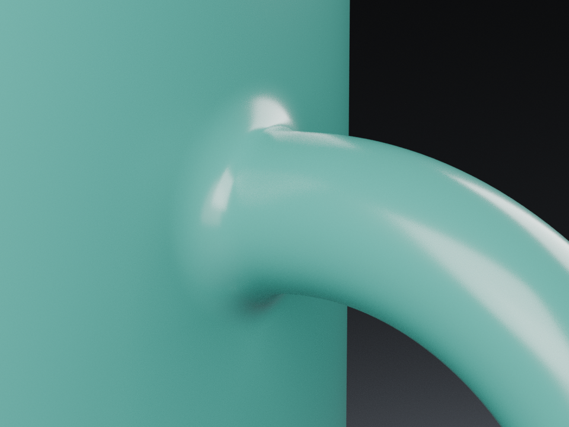
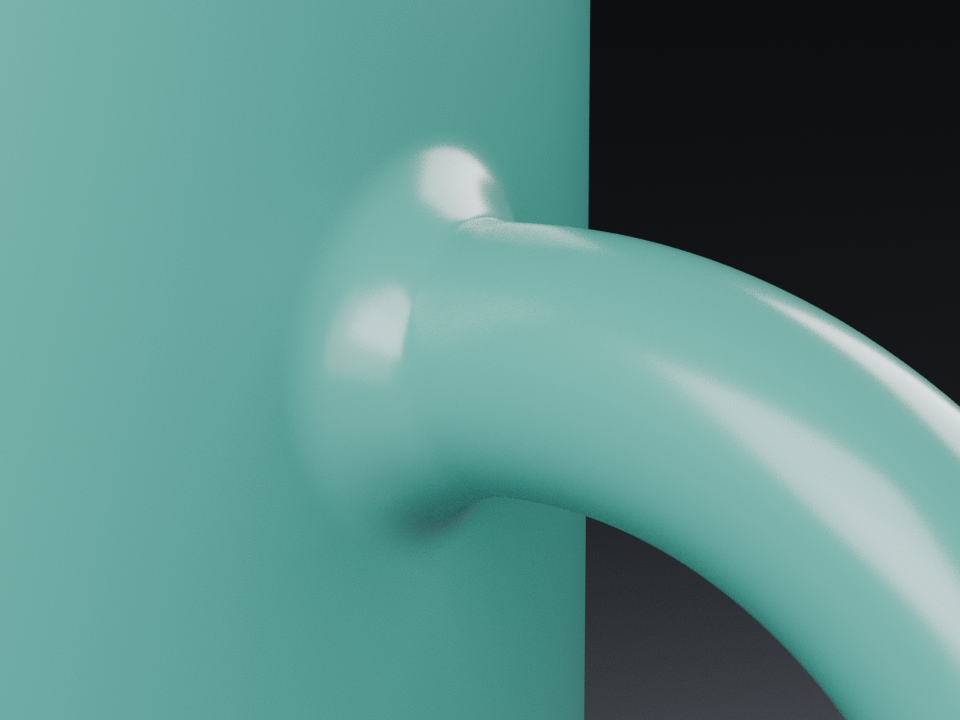
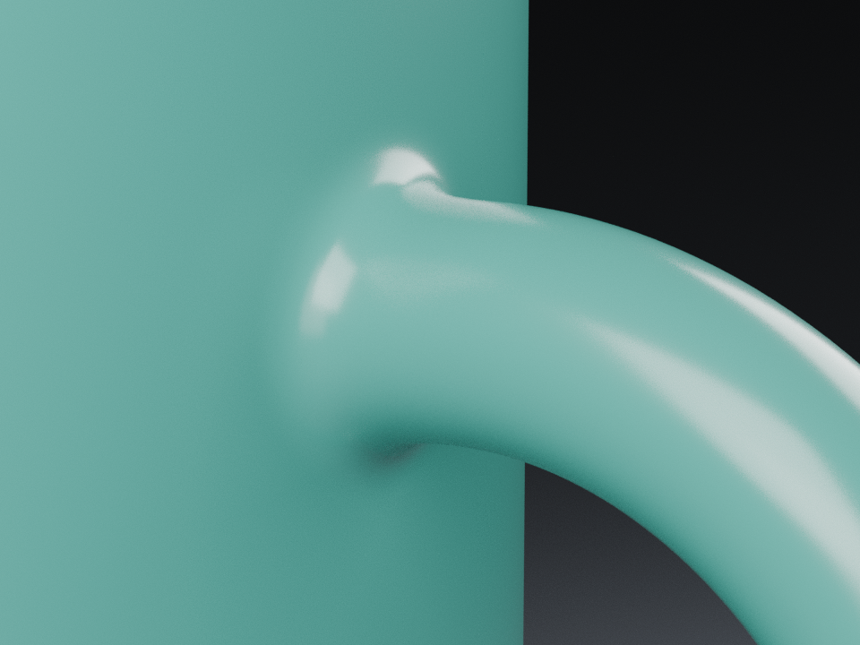
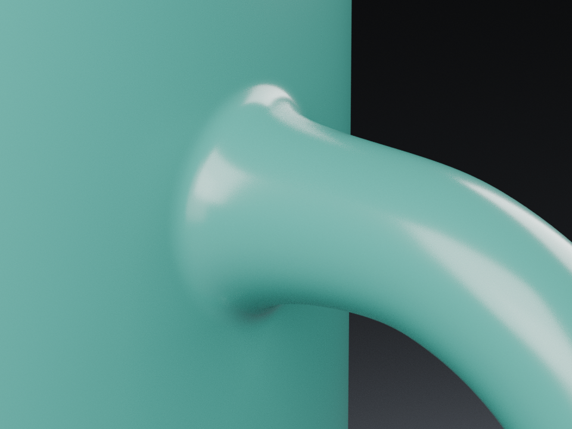

# 杯柄根部：固定机位基线与未采用的曲面实验

0.22 发布后，形体改进先回到青釉杯的上下接头。实际图片仍能看到接头周围的环状高光。四类机制、12 组实际重建与渲染完成，均未在上下接头的同条件实图中明确胜出，因此全部未采用；当前没有新增参数、配方或版本。下面先保留首组三组实验，再记录后续比较与失败修正。

## 从实际保存文件开始

基线来自已安装 0.22.0 的青釉杯 3.1.0 保存版本：高 105 mm、外径 80 mm、壁厚参数 3 mm，柄管半径 5.5 mm，根部半径 9 mm、长度 6 mm、`rootTension: 2.5`。原生成器已经具有五次端点位置、切线与曲率约束，以及解析角点法线；本轮不能把它们重新算作新能力。

先读取实际网格，再在原釉面、灯光与世界下渲染原主视角、原根部视角和新增的上下接头检查视角。下面与实验比较的两张基线均为第 24 帧、Cycles CPU、960×720、64 samples、seed 0，关闭去噪与自适应采样。检查相机固定，全部 PNG 原字节复制，没有裁切、缩放、调色或叠字。

| 上接头基线 | 下接头基线 |
| --- | --- |
|  |  |

实际网格为 29,514 顶点、37,332 面、一个连通分量，闭合且 Euler 特征为 0，体积为正。另从实际网格独立发出 3,362 条径向射线，其中 1,686 条依次命中内壁和根部外表面；这些位置的最小采样厚度为 2.910908 mm。它低于 3 mm 参数，但这里只能说明有限采样位置，不能称全表面最小壁厚或制造认证。

## 预先声明的三组实验

在任何产品源码编辑前，冻结三组临时原生实验。只对根部曲面增加轴向位移 `a × L × t³ × (1−t)³`，并使用它的精确一阶导数计算法线；`a` 分别为 8、16、24，最大位移为 0.75、1.5、2.25 mm。附加项在两端的位置、一阶与二阶导数均为零，保持已有端点约束。它只是一种待比较机制，没有成为产品字段。

每组均实际重建完整杯体，运行原构造器的闭合、连通性、体积、UV、角点法线与三角形相交检查；随后渲染同一对检查相机。杯身和杯柄主体的全部 31,188 个非根部面按有向循环及 UV 核对一致，整体尺寸保持，其余场景对象、相机、灯光、材质和世界事实保持。实际存储的非根部角点法线有小幅差异，下表保留测量值，不宣称逐字节相同。

| 实验 | 有限位置最小厚度 mm | 最大非根部法线向量差 | 实图决定 |
| --- | ---: | ---: | --- |
| 外鼓 8 | 3.000658 | 0.000495674 | 未采用：亮斑变宽，无明确观感收益 |
| 外鼓 16 | 3.000770 | 0.000485222 | 未采用：接头更像鼓包 |
| 外鼓 24 | 3.000886 | 0.000479143 | 未采用：鼓包和柄侧接痕更明显 |

| 外鼓 8，上接头 | 外鼓 8，下接头 |
| --- | --- |
|  |  |

| 外鼓 16，上接头 | 外鼓 16，下接头 |
| --- | --- |
|  |  |

| 外鼓 24，上接头 | 外鼓 24，下接头 |
| --- | --- |
|  |  |

以上是维护者逐张查看八张实际对照图的判断，不能代表外部美术认可。三组原生实验正常结束，全部 1,003 份产品来源文件的字节与模式、原保存版本和冻结实验输入保持；没有付费模型调用，也没有修改旧作品。三组成功执行不等于三组形体改进成功。

## 首轮决定与后续比较

单独向外推根部中段改善了有限壁厚采样，却把高光鼓包放大。随后继续研究轴向与横向联动、独立端部速度和延长连接段；每组均先声明有限实验，再保持同机位与同釉面比较。已有张力参数、灯光与材质不能代替这个形体目标。

数值、固定相机、全部三组结果及原始证据摘要见[验证记录](validation/cup-root-transition-1026.json)；八张原图的逐文件摘要见[图片清单](images/cup-root-transition/manifest.json)。本轮不替代未来实现后的完整回归、真实模型任务与发布验收。

### 后续九组也未进入产品

联动候选先经过预先声明的 247 组有限曲线采样。以采样曲率积分、外半径和轴向导数筛选后，选择三组进入实际原生比较。数值排名只用于缩小实验范围，不能决定观感。另两类机制分别保留原五次曲线但分开杯壁/柄管端部速度，以及将连接处移到柄管的既有截面，给过渡更长空间。

| 机制 | 三组预先声明的实际案例 | 结果与保留范围 |
| --- | --- | --- |
| 轴向/横向联动 | 系数 (10,2)、(10,4)、(8,4) | 完整杯身与柄管几何/UV、整体尺寸和场景保持；采样曲率更低，亮斑与鼓包仍明显，未采用 |
| 独立端部速度 | 杯壁/柄管速度系数 (2.5,1)、(2.5,1.5)、(2,1.5) | 完整杯身与柄管几何/UV、整体尺寸和场景保持；接头亮帽仍在，未采用 |
| 延长连接段 | 柄管截面角 7.5°、15°、22.5° | 全杯身、未替换的柄管中段及其原 UV、整体尺寸和场景保持；两端明确由新连接段替换。较长过渡更突出，未在上下两处明确胜出，未采用 |

为控制文档体积，每种新增机制展示一对代表原图。其余图片同样逐张查看；完整九组结果、18 张图片摘要和选择范围见[后续验证记录](validation/cup-root-followup-1026.json)。

| 轴向/横向 (10,4)，上接头 | 下接头 |
| --- | --- |
|  |  |

| 独立端部速度 (2.5,1.5)，上接头 | 下接头 |
| --- | --- |
|  |  |

| 延长至 22.5°，上接头 | 下接头 |
| --- | --- |
|  |  |

延长连接段的首次三组均被精确几何保护拒绝，未进入渲染。一个另行声明的原生诊断定位到下接头边界四个面：UV 面键完全相同，坐标最大差为 1.347×10⁻¹⁸ m，杯身零差异。原因是重合边界顶点由新根部先生成。临时实验将构造顺序改为杯身、原柄管、新根部，使原柄管坐标优先；同一三组案例随后通过原来的精确比较，没有增加容差，原失败保持。见[实际差异](validation/cup-root-span-protection-diagnostic-1026.json)。

延长段的端点位置、一阶和二阶导数另与独立圆环参数式核对；31 个非网格角度、五个内部位置、上下两处和三种跨度的有限差分核对 θ 导数，最大误差约 1.37×10⁻¹² m/rad。故意沿用旧 θ 导数时，三组都不能通过相同标准。它是有限数值验证，不能推广为连续参数域证明。见[导数读回](validation/cup-root-span-derivatives-1026.json)与[247 组纯数学采样](validation/cup-root-curve-sampling-1026.json)。

累计 12 个最终渲染案例、三次原保护拒绝和一次诊断，共执行 16 次完整原生构造检查；维护者查看 26 张比较图，另有原主视角与原根部概览两图。所有运行期间的完整来源字节/模式与原保存文件保持，付费模型调用为零。这里的“通过”只指各组明确声明的离散检查，没有把有限厚度或曲率改善写成艺术质量通过。

下一步先诊断实际截面与曲率，并确定有依据的连接形状目标，再考虑不同的圆角/过渡构造。停止继续无界扫描同一五次曲线族的系数。杯柄形体改善仍未完成，木构转角收口、曲面细节与真实外部采用也继续保留；本轮研究不算一个新稳定版本。
