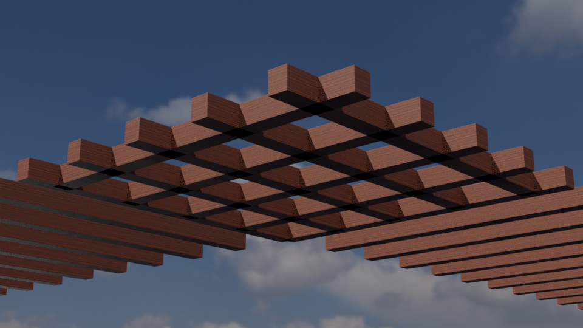
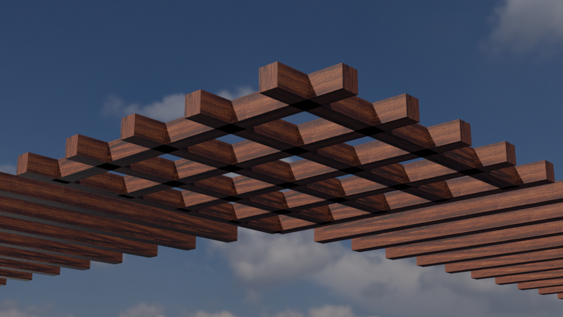
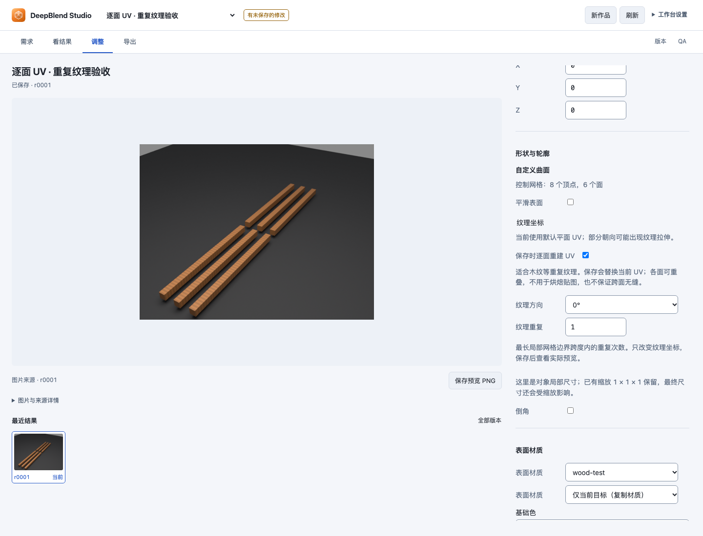

# 控制网格的按面 UV 投影：实际基线与实现目标

2026-10-27，本轮从真实佛塔 r0075 的两组檐口椽条开始。原生读回各有 50 个闭合部件，转角共 100 对存在严格共同内部点，证明有体积交叠；包围盒交叠体积只记录为上界。原始工程与六份修订文件保持，后续搭接仍需单独处理。

探针同时发现一个明确的表面问题：每组有 400 个零面积 UV 三角形。两份原控制网格都只有八个顶点、六个面，没有提供 `faceUvs`；既有缺省会投影到整个网格最长的两个轴，使其他朝向的面坍缩成线。提高采样或更换纹理不能补回缺失的面内坐标。

## 已实际比较的三个来源

从原保存文件抽取两组完整木条、原材质/内嵌图片、原灯光与世界、原檐口相机及其动画。使用原控制点、面、阵列和镜像重新生成，固定第 390 帧、Cycles CPU、960×540、48 samples、seed 0，无去噪或自适应采样。三个案例均生成原檐口机位与同一转角检查机位的图片，六张实际图片已逐张查看。

| 来源 | 两组零面积 UV 三角形 | 实际观察 |
| --- | --- | --- |
| 原缺省平面投影 | 400 / 400 | 部分面只剩拉伸条纹，重建后的原 UV 与保存来源一致 |
| 按面投影 | 0 / 0 | 木纹细节恢复，沿长边方向更合适 |
| 按面投影后转 90° | 0 / 0 | 纹理转到横跨长条的方向，本木材来源不优先采用 |

原缺省平面投影：

同材质、同摄影、同采样，只替换逐面 UV：

按面投影只计算已有格式的逐面角 `faceUvs`：以稳定的面法线与最长边建立平面坐标，使用整个控制网格的一致尺度保留比例，可明确转动四分之一圈。它不是 UV 岛打包，不保证跨面无缝或端纹真实。原生顶点、有向面、基础法线、世界矩阵、外边界、材质、灯光与原摄影事实均保持；三个实际保存文件已重新打开，几何与 UV 摘要一致。上述 100 对几何交叠仍在，不能将表面修正称为搭接完成。

首次搭接探针与首次 UV 探针均未改记为通过。前者暴露了旧 UV 问题和探针坐标错误；平移方块校准确认编辑操作使用世界坐标。后者因探针重新分解复制的 90° 变换，触发精确位姿保护；改为保留原变换后，同一标准通过。原日志和元数据更正记录保留。完整数值与图片摘要见[基线记录](validation/mesh-uv-baseline-1027.json)。

## 已接入的编辑操作

`entity.uv.project` 通过现有 `blender_scene_patch` 接收 `entityId`、可选 `quarterTurns`（0–3，缺省 0）和 `scale`（0.0001–10000，缺省 1）。它只适用于 `shape: "mesh"` 的生成器，将计算结果写成已有逐面角 `faceUvs`，保留其它场景数据。非平面面片会拒绝并提示先拆为平面面片；其它形状和导入资产不会被猜测处理。`scale` 是最长局部坐标边界跨度内的重复次数；越大，纹理重复越多。UV 岛从各自的零点开始，允许重叠，不进行图集打包。

原缺省和已有手工 UV 在未请求重新生成时保持。工作台沿用光台和对象编辑器：选中自定义曲面，在“纹理坐标”中勾选“保存时逐面重建 UV”，选择方向和重复次数，再用现有保存按钮提交并查看实际预览。字段修改只进入草稿；与控制点编辑一起保存时先更新控制网格，再计算 UV。

图片来自实际原生渲染或浏览器。文档副本只补充来源元数据，解码像素与保留原图逐字节一致；详见[图片来源记录](assets/mesh-uv/provenance.json)。

针对性数学和事务检查覆盖面内比例与统一密度、四方向、重复次数、手工 UV 替换、输入不变、重复操作无变更、同次控制点编辑顺序，以及错误目标和非平面面片的原子拒绝。真实浏览器/Host/Blender 专项使用明确标注的六木条验收模型：保存只发送一条语义操作；独立重开后 48 个零面积 UV 三角形变为 0，48 个顶点、36 个面和原生几何/对象摘要保持。固定渲染配置的图片有实际像素变化；刷新不再暂存重建，原修订文件保持，同一请求重放没有产生新修订。

独立界面审阅要求为越界重复次数增加邻近范围反馈及读屏关联；修正后的桌面、390 像素、浅色和深色错误状态已再次查看，审阅对这一项修正的结论为 resolved / ship。已有设计系统文件保持；这是局部修正的结论，不是全站重新认证。

首次真实自然语言对照没有取得完整交付：旧版第 4 次请求流中断；候选在 6 次源码查找后用两条新操作保存 r0003，独立重开确认两组各 400 个退化 UV 三角形归零，几何与五个摄影样本保持。候选实际产生了第 390 帧、1920×1080 的材质检查图，采样从 32 自动降到 16；第 10 次请求后被既定上限截住，没有最终答复。不能将它写成完整模型任务通过，更不能把旧版网络失败当成新版优势。

原量具仅接受普通预览且强制 768×432，范围过窄；原失败保留，并另行说明材质检查图也是合法图像结果。后续量具应核对图片来源、保存版本、原相机和帧，渲染设置差异单独记录。工具说明和技能现已明确 U 沿面内最长局部边、四分之一圈旋转 UV 坐标、复制旋转不改变局部基准，以及普通预览与独立检查图的区别，避免通过读实现才能选择参数。原完整验收在修改前停止，保留七项通过和实际 -15，不作为整轮通过。

第二组全新会话使用相同两组原木条、材质图片、天空、摄影动画与同一任务图片，事先声明每版最多 12 次请求、40 次工具调用、8 分钟和一次尝试，不延续首次中断。候选使用已冻结的 `ee93381571e8ba1da9446ee11923ac0bd4f04b7d` 产品字节，11 次模型请求、16 次工具调用正常完成；两条 `entity.uv.project` 操作以 `quarterTurns: 0`、`scale: 2` 保存 r0003，并展示原相机第 390 帧 768×432、16 采样的普通预览。独立重开与 UV 边长比例共 16 项通过：两组各 400 个退化三角形归零，原生几何、对象事实及五个原相机动画样本保持。维护者实际查看了同帧前后图和第 470 帧的补充材质检查图。交叉搭接仍然存在。

旧版第二组在首次请求连接失败，没有工具调用；两组对照均不能支持新版成功率或速度优于旧版的结论。图像量具的 12 个校准案例验证了实际材质检查图可接受，并拒绝错误来源、相机、帧、灰模、像素哈希与素材绑定。首次失败、旧版连接错误和候选最终文字均保持。最终文字将亮度四舍五入为 0.180 后与 0.18 阈值比较，原始未舍入数值另留，不能据此推断新的曝光缺陷。

额外运行原有付费检查：真实工具卡 10/10 通过；视觉审查 10/14，首次响应流终止，随后审查与修复回路有实际回答。这个外部模型失败保持为失败，不纳入 UV 任务通过数，也不声称艺术审查全部通过。

目前尚未发布 0.23。最终冻结完整验收、确切提交的 CI、构建安装和标准发布仍待完成。搭接几何与其它复杂模型改进继续保留。

冻结 `4e03b884` 的连续 49 套验收已全部通过，1,036 份跟踪源码字节和隔离宿主 CLI 保持。
其 CI 的杯尺寸作业两次在中文字体下载阶段超时，原生步骤未启动；失败保留，随后修复官方源下载、
包校验与缓存。模型实际使用的 202 份产品/规范 preset/版本清单保持，后续变化限定为 CI、测试、
文档。修复后最终来源仍须连续完整验收、确切提交 CI 和构建安装，当前尚未发布 0.23。

后续 `41eedff` 冻结来源的连续 49 套及 CI `40415524267` 五项、四份产物均通过，合并时完整
1,037 份文件与模式保持。合并后的主分支现代宿主准备再次失败：已核验的本地字体被 APT 按索引
重新从网络获取。原始失败 ZIP 与字体报告保留，原生步骤未启动，未发布 0.23。随后将字体安装
改为其它依赖准备后重新核对本地包，再由 dpkg 直接安装，保留实际输出；错误不重试或回退 APT。
新的完整冻结验收与真实 Linux CI 待执行，产品、界面与原模型使用的 202 份字节保持。
