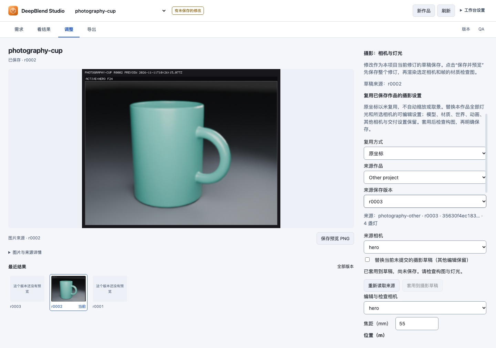
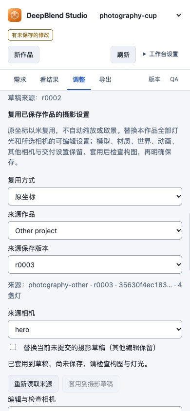

# 摄影编辑

[English guide](photography-editor.en.md) · **简体中文**

## 改动前检查

2026-10-04，在 main `0b24f58` 的独立工作树运行现有 `scene-editor.test.mjs`：40 项通过。检查场景投影发现相机缺少 transform/targetPoint 等完整字段，灯光缺少 color/size 等完整字段；场景页二者只有文字列表。最初先运行客户端与协议检查；后续真实浏览器与 Blender 专项结果见文末。

## 使用方式

在场景页的“摄影：相机与灯光”中选择已有相机，修改焦距、位置及瞄准对象原点或指定坐标。相机可选择自由旋转、对象原点或坐标目标。切回自由旋转会明确清除旧瞄准目标；使用目标时，旋转输入由目标控制。相机动画驱动的位置和旋转轴锁定，旋转动画存在时也锁定瞄准设置。

选择已有灯光可改位置、旋转、能量、RGB 和尺寸。原有类型只读；“新增面积补光灯”会创建独立 ID 的面积灯草稿。面积灯尺寸显示方形边长，点光与聚光显示柔光半径，太阳光单独显示强度且没有无效尺寸输入。完整定义保留原有 scale、sensorWidth、clipping、fStop、spotSize、spotBlend 和 angle 等未改字段。

这里选择的是编辑和检查用相机；项目的活动相机和最终交付机位不会随此选择改变。 检查图按原尺寸显示，空间不足时缩小；小尺寸图片不会自动拉伸到面板宽度。

选择相机、帧与采样数后，点击“保存并预览”。保存请求复用 ScenePatch，固定草稿的 projectId/baseRevision，并设置 saveCheckpoint:true、renderPreview:false。保存回执的 revision 和 digest 决定随后材质检查图的来源；相机、帧和采样数来自点击时的草稿。客户端立即刷新当前场景，但不会用刷新结果替换这次图片请求的来源。

图片失败或取消时显示“修订已保存”，保留该次保存记录。“重试已保存修订的预览”只重试图片，即使当前修订后来改变，也仍读取原来保存的修订。“恢复摄影编辑前的场景”恢复整个场景，以编辑后的 revision 作为 expectedCurrentRevision；并发变化时拒绝覆盖，保留编辑记录和现有草稿。

轮询不会覆盖有改动的草稿。切换项目后可回到该项目继续编辑；草稿来源与当前修订不同则禁止保存，可显式放弃草稿并重新读取当前值。已保存字段由 Host 场景重新读取；未保存草稿和本次保存/恢复记录只在当前页面会话保留。

这里的瞄准对象是根原点，不是包围盒中心，也不是运动跟踪约束。不提供未保存草稿试渲染、自动取景或曝光/环境编辑。旧 Host 仍可使用原有摄影编辑；复用与清除目标需要更新插件并重启 DSH。

## 完整取景

移动模型后，原相机可能只拍到背景。在「调整 → 摄影与灯光 → 完整取景」中，选择沿用取景方向的相机和明确取景帧，然后点击「保存完整取景」。整盏台灯默认选择全部 23 个部件，包含灯泡和电线，不含地面或外部支承。可展开「选择部件与留白」调整选择，或点击「选择整盏灯」恢复整件选择。留白默认每侧 3%。

保存会测量真实 Blender 几何，沿用来源相机在该帧的方向、滚转和光学设置，新增一个静态机位。独立核验全部选中几何在画幅与裁剪范围内后，才保存新版本并显示实际预览。原相机、动画和镜头安排保留；最终交付机位不会自动切换。

请先保存或放弃其他草稿。版本变化时，点击「重新读取当前版本」再调整。保存结果尚未确认时，输入会锁定；「重试同一次保存」沿用同一部件选择、版本和机位，不会重复创建相机。刷新页面后回到「调整 → 摄影与灯光」可继续这次重试。浏览器必须允许本站保存重试信息，才能发送请求。取消会中止当前操作；连接中断后仍需读取或重试来确认最终状态。

核验只针对明确帧和当前预览画幅的完整几何边界。请看预览检查遮挡与美术效果；更换交付画幅后需重新检查。它不核验透明材质、着色器位移或整个动画范围。不支持的隐藏部件、模拟或过重几何会明确拒绝。

## 复用已保存摄影设置

在摄影面板选择“来源作品”和“来源保存版本”，再选择来源相机。读取的是明确的保存版本，不会随着来源作品当前指针改变。面板显示来源作品、版本、摘要和灯光数；网络读取失败可重新读取，错误身份或迟到的旧选择不能替换后来选择。

“套用到摄影草稿”会替换目标作品的全部灯光，以及当前所选相机的焦距、位置、朝向或瞄准设置。目标相机的 ID、用途、传感器、光圈、裁剪范围与缩放保留；其他相机、模型、材质、世界、动画、镜头安排和交付设置保持。若已有未提交摄影修改，须先勾选明确替换摄影草稿；其他未提交编辑保持。

来源相机瞄准对象时，必须在目标作品中明确选择瞄准对象，不能沿用另一作品的对象 ID。动画锁定仍有效，存在冲突时拒绝套用，保留原草稿。来源灯光保留完整定义，包括原类型、光色、尺寸、位置与旋转，以及聚光和太阳参数。

默认按原坐标以米直接复用。两件尺寸或位置不同的作品可能需要继续调整位置、灯光和瞄准点。保存版本记录复用来源作品、版本、摘要和相机；保存前仍可继续调整草稿。套用后检查参数，明确“保存并预览”才会生成版本与检查图。读取与套用不会保存场景；保存后仍可重试原保存版本的图片或按现有条件恢复整个旧场景。

### 候选：按产品边界适配

当前未发布工作区增加了可选的边界适配；公开 0.23.0 和较早本地候选不含此增量。它适合静态产品的尺寸、位置改变后复用一套已保存的摄影设置。在“复用方式”选择边界适配，指定来源相机与来源帧，分别展开来源、目标产品部件，核对整件产品。选中完整导入实例时会读取其全部子网格。地面、支承和布景应排除；默认部件只是起点，仍需核对。

点击“套用到摄影草稿”后，Host 读取两个保存工程的真实边界，以边界对角线之比统一缩放机位与灯光相对产品中心的位置。复制来源相机在明确帧的焦距与朝向，目标传感器、偏移、光圈和裁剪范围保留；启用景深时重新计算目标对焦距离。非太阳灯的尺寸随比例变化，功率随比例平方变化；太阳强度和角度保持。模型、材质、环境、其他机位、动画和输出设置保持。

这是一项摄影起点，不保证不同形状、长宽比、材质和环境得到相同构图或亮度。先检查草稿，再保存预览；必要时使用完整取景。规划期间可以取消；失败、版本变化或迟到回执会保留原草稿，不会偷偷改用原坐标。保存记录包含原始版本、工程摘要、所选部件摘要、帧和适配比例。

每侧最多选择 128 个实体或完整实例，合计最多 128 个网格、两百万顶点或多边形；最多 32 盏已命名灯光。产品及其几何依赖、目标机位和灯光须静态。来源机位可有动画，但只采样明确帧，不迁移整段运动。隐藏成员、未管理的活动光源、自定义灯光节点、模拟或不同的视口／渲染几何会拒绝。静态 Boolean 工具可以作为几何依赖读取，不应被误选为产品。旧 Host 不支持此方式时会提示升级，仍可明确选择原坐标复用。

2026-11-01 的真实浏览器、Host 和 Blender 专项使用静态台灯夹具：目标整体放大两倍并平移，原坐标预览只显示背景，边界适配后重新完整入画并保存。13 项浏览器流程检查通过，独立重开工程对全部 23 个部件的 51,786 个顶点投影、几何、UV、法线、材质和其它机位核对通过。14 个原生对照覆盖 128 成员、静态 Boolean、动画来源机位，以及隐藏、动画依赖、额外光源和超量网格等拒绝分支。证据在 `.deepblend/quality/photography-bounds-ui-disclosure-20261101/` 和 `.deepblend/quality/camera-fit-photography-20261101/`。640×360、16 samples 图片仅作功能检查；这不是用户自有模型、非维护者试用或美术放行。





图片来自[实际专项来源](assets/photography-reuse/manifest.json)，用于说明操作，不代表外部用户采用。

当前图片来自光台工作台候选的实际浏览器操作：在“调整 → 摄影与灯光”展开工具，读取明确的保存摄影版本，按默认原坐标方式替换 r0002 的未提交摄影草稿。图片只展示套用到草稿的状态；未点击保存，131 份 Host 文件在操作前后字节保持。截图前已准备现有目标预览。当前 UI 截图、边界适配专项与下面较早的 36 项原生回归分别记录。公开稳定状态以[每日发布记录](daily-releases.md)为准。

## 已做检查与待验收

客户端与协议检查覆盖字段深克隆及未改字段保留、目标互斥与动画保护、光源类型和新增面积灯、错误输入、项目/修订草稿隔离、重复点击、保存拒绝、固定来源重试、取消、回执身份校验和条件恢复。现有对象编辑、固定视角检查、场景投影、独立工作台及双语文案检查通过。源码故意丢字段、漏更新、绕过目标/动画锁、覆盖草稿、改错预览来源或移除恢复条件时，摄影用例均失败；执行后源码摘要恢复。

### 历史：最初摄影编辑专项

最初的实际 Chrome/Host/Blender 专项通过 23 项：

- 真实表单修改杯体相机焦距、位置、目标点及灯光能量/尺寸，新增面积灯并生成图片；项目切换和轮询保留各自草稿及输入焦点。
- 独立重开三个 checkpoint，核对相机、灯光和未改光学字段，几何、UV、法线及材质节点保持。
- 同一 CPU、单线程、种子及摄影条件下重复基线像素相同；仅修改灯光后像素变化。取景修改后杯体仍在相机范围内；取景与新增灯同时发生的图片不作为单因素对比。
- 条件恢复、刷新读回、旧文件原字节保护及窄屏输入的水平范围已检查。已查看三张页面截图与实际前后图片；窄屏截图只覆盖相机区，未声称完整移动操作流程通过。

该次原始专项记录在 `.deepblend/quality/photography-editor/browser-native-v1/`。图片为小尺寸功能检查，不能替代成品质量评审。当时浏览器中的取消、失败重试和并发拒绝主要由客户端/协议用例覆盖，最初专项不覆盖这些分支。

### 2026-10-22：摄影复用回归

未发布可编辑副本候选 `d68f6d452b476c8c0b4c8fb6739b13c7ef59112f` 的真实 Chrome/DSH/Blender 专项通过 36/36 检查，原始记录位于仓库相对目录 `.tmp-photography-reuse-1022-v1/`。这次使用杯子回归夹具，无模型调用，不是宝塔案例的艺术验收、完整影片验收或可编辑副本导出验收。

本轮除原有摄影编辑、固定来源检查图、像素对照和条件恢复外，还覆盖明确读取历史摄影版本、来源读取失败后的恢复、显式替换已有摄影草稿、只读套用到目标草稿、一次保存完整来源相机与灯光，以及保存操作历史中的来源记录。目标模型、材质、世界、镜头安排、其他相机、动画与交付设置保持；独立重开目标 checkpoint 核对原生相机、完整灯光和自由旋转，原场景与 checkpoint 字节保持。

这次较早专项的原始截图为 `04-reused-photography-draft.png` 与 `05-narrow-photography-reuse.png`，其记录由来源清单的 `nativeRegression` 保留。上方图片已更新为光台候选的实际桌面 1440×1013 与窄屏 390×844 画面；浏览器返回 JPEG 编码，已转存为 PNG，并核对解码像素完全相同，未裁剪、缩放、调色或加字。两张均已查看。新截图验证已保存来源、草稿替换、展开区在输入和轮询后保持，以及窄屏控件范围；它没有重新执行较早的 36 项原生专项。[当前截图报告](assets/photography-reuse/capture-report.json)与[来源清单](assets/photography-reuse/manifest.json)分别绑定当前 UI 摘要及较早原生报告的摘要，不互相替代验收。

复现时使用 Node.js 24，按[开发环境说明](../../CONTRIBUTING.md)安装并链接本检出的依赖，准备真实 Chrome、Blender 和隔离 DSH 运行时。将下例两个路径替换为实际 DSH 安装根目录和 Blender 可执行文件路径；输出目录必须尚不存在，专项会创建独立项目与 DSH profile，不调用模型：

```bash
export DEEPBLEND_DSH_ROOT="/path/to/isolated-dsh"
export DEEPBLEND_BLENDER_PATH="/path/to/blender"
node deepblend/tools/link-workspace.mjs
DEEPBLEND_E2E_ARTIFACTS="$PWD/.tmp-photography-reuse-rerun-$(date -u +%Y%m%dT%H%M%SZ)" \
node deepblend/tests/e2e/photography-ui.e2e.mjs
```

复现后检查 `report.json` 中的 `status` 与全部 36 条检查，并保留 `requests.json`、`reuse-requests.json`、原生重开记录和原始图片。浏览器保存后的取消、检查图失败重试及并发拒绝分支，仍须结合客户端/协议用例判断；本轮实际验证的失败恢复是摄影来源读取失败。完整连续验收、Linux CI 与发布状态按最终整合源码分别核对。
