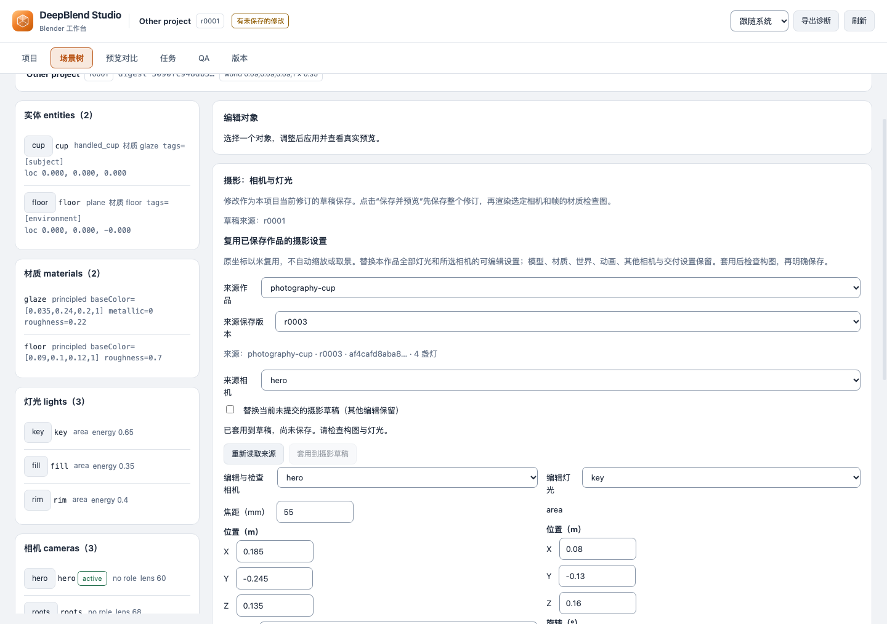
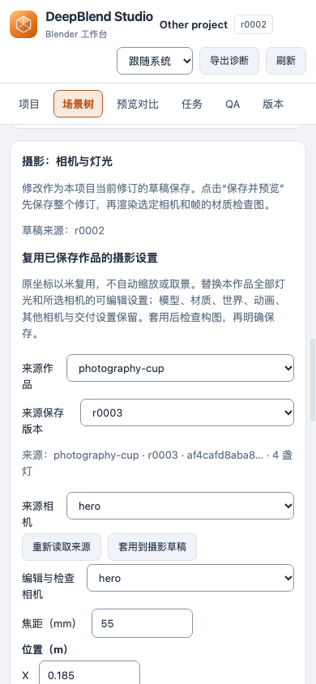

# 摄影编辑

## 改动前检查

2026-10-04，在 main `0b24f58` 的独立工作树运行现有 `scene-editor.test.mjs`：40 项通过。检查场景投影发现相机缺少 transform/targetPoint 等完整字段，灯光缺少 color/size 等完整字段；场景页二者只有文字列表。最初先运行客户端与协议检查；后续真实浏览器与 Blender 专项结果见文末。

## 使用方式

在场景页的“摄影：相机与灯光”中选择已有相机，修改焦距、位置及瞄准对象原点或指定坐标。相机可选择自由旋转、对象原点或坐标目标。切回自由旋转会明确清除旧瞄准目标；使用目标时，旋转输入由目标控制。相机动画驱动的位置和旋转轴锁定，旋转动画存在时也锁定瞄准设置。

选择已有灯光可改位置、旋转、能量、RGB 和尺寸。原有类型只读；“新增面积补光灯”会创建独立 ID 的面积灯草稿。面积灯尺寸显示方形边长，点光与聚光显示柔光半径，太阳光单独显示强度且没有无效尺寸输入。完整定义保留原有 scale、sensorWidth、clipping、fStop、spotSize、spotBlend 和 angle 等未改字段。

这里选择的是编辑和检查用相机；项目的活动相机和最终交付机位不会随此选择改变。 检查图按原尺寸显示，空间不足时缩小；小尺寸图片不会自动拉伸到面板宽度。

选择相机、帧与采样数后，点击“保存并预览”。保存请求复用 ScenePatch，固定草稿的 projectId/baseRevision，并设置 saveCheckpoint:true、renderPreview:false。保存回执的 revision 和 digest 决定随后材质检查图的来源；相机、帧和采样数来自点击时的草稿。客户端立即刷新当前场景，但不会用刷新结果替换这次图片请求的来源。

图片失败或取消时显示“修订已保存”，保留该次保存记录。“重试已保存修订的预览”只重试图片，即使当前修订后来改变，也仍读取原来保存的修订。“恢复摄影编辑前的场景”恢复整个场景，以编辑后的 revision 作为 expectedCurrentRevision；并发变化时拒绝覆盖，保留编辑记录和现有草稿。

轮询不会覆盖有改动的草稿。切换项目后可回到该项目继续编辑；草稿来源与当前修订不同则禁止保存，可显式放弃草稿并重新读取当前值。已保存字段由 Host 场景重新读取；未保存草稿和本次保存/恢复记录只在当前页面会话保留。

这里的瞄准对象是根原点，不是包围盒中心，也不是运动跟踪约束。不提供未保存草稿试渲染、自动取景或曝光/环境编辑。旧 Host 仍可使用原有摄影编辑；复用与清除目标需要更新插件并重启 DSH。

## 复用已保存摄影设置

在摄影面板选择“来源作品”和“来源保存版本”，再选择来源相机。读取的是明确的保存版本，不会随着来源作品当前指针改变。面板显示来源作品、版本、摘要和灯光数；网络读取失败可重新读取，错误身份或迟到的旧选择不能替换后来选择。

“套用到摄影草稿”会替换目标作品的全部灯光，以及当前所选相机的焦距、位置、朝向或瞄准设置。目标相机的 ID、用途、传感器、光圈、裁剪范围与缩放保留；其他相机、模型、材质、世界、动画、镜头安排和交付设置保持。若已有未提交摄影修改，须先勾选明确替换摄影草稿；其他未提交编辑保持。

来源相机瞄准对象时，必须在目标作品中明确选择瞄准对象，不能沿用另一作品的对象 ID。动画锁定仍有效，存在冲突时拒绝套用，保留原草稿。来源灯光保留完整定义，包括原类型、光色、尺寸、位置与旋转，以及聚光和太阳参数。

坐标以米直接复用，不会按模型大小自动缩放或重新取景。两件尺寸不同的作品可能需要继续调整位置、灯光和瞄准点。保存版本记录复用来源作品、版本、摘要和相机；保存前仍可继续调整草稿。套用后检查参数，明确“保存并预览”才会生成版本与检查图。读取与套用均为只读操作；保存后仍可重试原保存版本的图片或按现有条件恢复整个旧场景。





图片来自[实际专项来源](assets/photography-reuse/manifest.json)，用于说明操作，不代表外部用户采用。

当前图片和下述最新专项来自 2026-10-22 的未发布可编辑副本候选，用于验证摄影编辑与复用回归。公开稳定状态以[每日发布记录](daily-releases.md)为准；这次摄影专项本身不证明候选已完成完整验收或公开发布。

## 已做检查与待验收

客户端与协议检查覆盖字段深克隆及未改字段保留、目标互斥与动画保护、光源类型和新增面积灯、错误输入、项目/修订草稿隔离、重复点击、保存拒绝、固定来源重试、取消、回执身份校验和条件恢复。现有对象编辑、固定视角检查、场景投影、独立工作台及双语文案检查通过。源码故意丢字段、漏更新、绕过目标/动画锁、覆盖草稿、改错预览来源或移除恢复条件时，摄影用例均失败；执行后源码摘要恢复。

### 历史：最初摄影编辑专项

最初的实际 Chrome/Host/Blender 专项通过 23 项：

- 真实表单修改杯体相机焦距、位置、目标点及灯光能量/尺寸，新增面积灯并生成图片；项目切换和轮询保留各自草稿及输入焦点。
- 独立重开三个 checkpoint，核对相机、灯光和未改光学字段，几何、UV、法线及材质节点保持。
- 同一 CPU、单线程、种子及摄影条件下重复基线像素相同；仅修改灯光后像素变化。取景修改后杯体仍在相机范围内；取景与新增灯同时发生的图片不作为单因素对比。
- 条件恢复、刷新读回、旧文件原字节保护及窄屏输入的水平范围已检查。已查看三张页面截图与实际前后图片；窄屏截图只覆盖相机区，未声称完整移动操作流程通过。

该次原始专项记录在 `.deepblend/quality/photography-editor/browser-native-v1/`。图片为小尺寸功能检查，不能替代成品质量评审。当时浏览器中的取消、失败重试和并发拒绝主要由客户端/协议用例覆盖，最初专项不覆盖这些分支。

### 2026-10-22：摄影复用回归

未发布可编辑副本候选 `d68f6d452b476c8c0b4c8fb6739b13c7ef59112f` 的真实 Chrome/DSH/Blender 专项通过 36/36 检查，原始记录位于仓库相对目录 `.tmp-photography-reuse-1022-v1/`。这次使用杯子回归夹具，无模型调用，不是宝塔案例的艺术验收、完整影片验收或可编辑副本导出验收。

本轮除原有摄影编辑、固定来源检查图、像素对照和条件恢复外，还覆盖明确读取历史摄影版本、来源读取失败后的恢复、显式替换已有摄影草稿、只读套用到目标草稿、一次保存完整来源相机与灯光，以及保存操作历史中的来源记录。目标模型、材质、世界、镜头安排、其他相机、动画与交付设置保持；独立重开目标 checkpoint 核对原生相机、完整灯光和自由旋转，原场景与 checkpoint 字节保持。

上方两张图片直接复制本轮原始 `04-reused-photography-draft.png` 与 `05-narrow-photography-reuse.png`，尺寸分别为 1440×1013 和 390×844，未裁剪或后期处理。两张均已实际查看，复用控件清晰，窄屏没有水平溢出；图片用于说明摄影复用操作，不替代成品观感评审。截图字节、尺寸、UI、测试工具以及原始报告和请求记录的 SHA-256 均记录在[来源清单](assets/photography-reuse/manifest.json)。

复现时使用 Node.js 24，按[开发环境说明](../../CONTRIBUTING.md)安装并链接本检出的依赖，准备真实 Chrome、Blender 和隔离 DSH 运行时。将下例两个路径替换为实际 DSH 安装根目录和 Blender 可执行文件路径；输出目录必须尚不存在，专项会创建独立项目与 DSH profile，不调用模型：

```bash
export DEEPBLEND_DSH_ROOT="/path/to/isolated-dsh"
export DEEPBLEND_BLENDER_PATH="/path/to/blender"
node deepblend/tools/link-workspace.mjs
DEEPBLEND_E2E_ARTIFACTS="$PWD/.tmp-photography-reuse-rerun-$(date -u +%Y%m%dT%H%M%SZ)" \
node deepblend/tests/e2e/photography-ui.e2e.mjs
```

复现后检查 `report.json` 中的 `status` 与全部 36 条检查，并保留 `requests.json`、`reuse-requests.json`、原生重开记录和原始图片。浏览器保存后的取消、检查图失败重试及并发拒绝分支，仍须结合客户端/协议用例判断；本轮实际验证的失败恢复是摄影来源读取失败。完整连续验收、Linux CI 与发布状态按最终整合源码分别核对。
